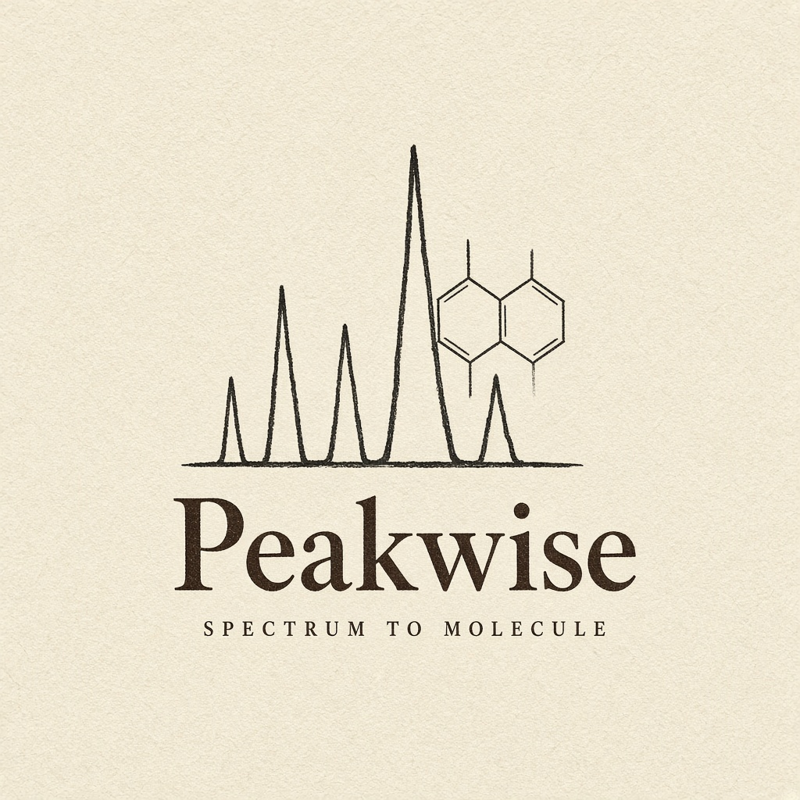

# Peakwise

**Name the molecule in your mass spectrum.**

Live site: [https://arnold-rg.github.io/peakwise/](https://arnold-rg.github.io/peakwise/)

A mass spectrometer can see thousands of compounds in a drop of blood. It does not tell you their names. Peakwise is a small, readable tool that takes an LC-MS/MS peak list and ranks chemical structures (SMILES) — for known drugs and metabolites, and for close cousins that might be new medicines or disease markers.

The public site runs **in any modern browser**, including phones. GitHub Pages publishes it from `master` (the workflow is `.github/workflows/pages.yml`). The full local copy adds the trained fingerprint model.



## Use it on any device

| Where | What you get |
| --- | --- |
| GitHub Pages | Identify tab with bundled examples, library browse, glossary, scores |
| Local copy | Same UI plus the trained model, analog generator, batch MGF |

The Pages site is demo mode (no install). Phones can use the home-screen icon from `manifest.webmanifest`.

## Run locally (full model)

Use Python 3.12. NumPy 1.26.4 does not publish wheels for Python 3.13.

```bash
git clone https://github.com/Arnold-RG/peakwise.git
cd peakwise
python -m venv .venv
```

macOS and Linux:

```bash
.venv/bin/python -m pip install -r requirements.txt
.venv/bin/python scripts/build_library.py
.venv/bin/python -m uvicorn backend.app.main:app --host 127.0.0.1 --port 8000
```

Windows:

```powershell
.\.venv\Scripts\python.exe -m pip install -r requirements.txt
.\.venv\Scripts\python.exe scripts/build_library.py
.\.venv\Scripts\python.exe -m uvicorn backend.app.main:app --host 127.0.0.1 --port 8000
```

In a second terminal, from `<your-folder>/peakwise`:

```bash
cd frontend
npm install
npm run dev
```

Open [http://127.0.0.1:5173](http://127.0.0.1:5173). The dev server proxies `/api` to the API on port 8000.

## How to identify a spectrum

1. Open **Identify**.
2. Leave the caffeine list, or paste `mass height` pairs (spaces or commas).
3. Press **Name this spectrum**.
4. Read the ranked names, the “why this ranking” notes, and the mirror plot.

If a word is unfamiliar, open **Plain English**.

## What is inside

- Library search (cosine + modified cosine)
- Fingerprint model (local)
- Formula guessing from precursor mass
- Nearby-molecule edits for novel guesses
- Batch MGF/MSP (local API)
- Held-out scaffold metrics

## Held-out numbers (bundled set)

| | Top-1 | Top-10 | Tanimoto@1 |
|---|---|---|---|
| Hybrid | 67% | 100% | 0.75 |
| Cosine | 71% | 100% | 0.82 |

## Layout

```
backend/app/     chemistry, spectra, model, API
frontend/         Peakwise UI (GitHub Pages)
scripts/          library build + training
```

Not a medical device. Treat every name as a hypothesis.
