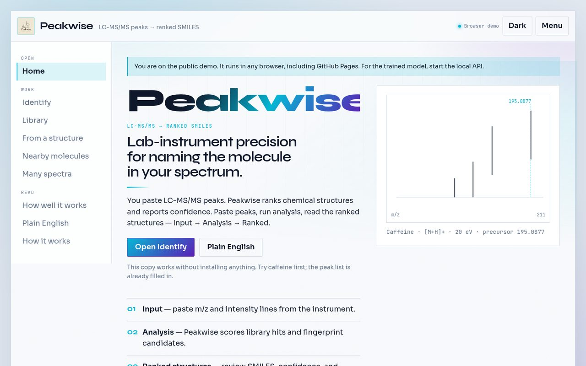

# Peakwise

**Name the molecule in your mass spectrum.**

[](https://arnold-rg.github.io/peakwise/)
[](LICENSE)

**Live:** [https://arnold-rg.github.io/peakwise/](https://arnold-rg.github.io/peakwise/)

A mass spectrometer can see thousands of compounds in a drop of blood. It does not tell you their names. Peakwise takes an LC-MS/MS peak list and ranks chemical structures (SMILES) — for known drugs and metabolites, and for close cousins that might be new medicines or disease markers.

The public site runs in any modern browser, including phones. GitHub Pages publishes it from `master`. The full local copy adds the trained fingerprint model.

[](https://arnold-rg.github.io/peakwise/)

## Features

- Identify tab: paste `mass height` pairs, or use the bundled caffeine example
- Ranked names with “why this ranking” notes and a mirror plot
- Library search (cosine and modified cosine)
- Formula guessing from precursor mass
- Nearby-molecule edits for novel guesses (local API)
- Batch MGF/MSP (local API)
- Plain-English glossary

| Where | What you get |
| --- | --- |
| GitHub Pages | Identify tab with bundled examples, library browse, glossary, scores (demo mode) |
| Local copy | The same UI plus the trained fingerprint model, analog generator, and batch MGF |

This is not a medical device. Treat every name as a hypothesis.

## Tech stack

| Layer | Tools |
| --- | --- |
| Backend | Python, FastAPI, NumPy, pandas, scikit-learn, SciPy, RDKit |
| Frontend | TypeScript, Vite, Tailwind CSS |
| Hosting | GitHub Pages via `.github/workflows/pages.yml` |
| License | MIT — see [LICENSE](LICENSE) |

## Getting started

```bash
git clone https://github.com/Arnold-RG/peakwise.git
cd peakwise
python3 -m venv .venv
source .venv/bin/activate   # Windows: .venv\Scripts\activate
pip install -r requirements.txt
python scripts/build_library.py
uvicorn backend.app.main:app --host 127.0.0.1 --port 8000
```

In another terminal:

```bash
cd frontend
npm install
npm run dev
```

Open [http://127.0.0.1:5173](http://127.0.0.1:5173).

### How to identify a spectrum

1. Open **Identify**.
2. Leave the caffeine list, or paste `mass height` pairs (spaces or commas).
3. Press **Name this spectrum**.
4. Read the ranked names, the ranking notes, and the mirror plot.

If a word is unfamiliar, open **Plain English**.

## Project structure

```text
backend/app/     Chemistry, spectra, model, and API
frontend/         Peakwise UI (GitHub Pages build)
scripts/          Library build and training
notebooks/        Exploratory analysis
models/           Trained model artefacts
```

## Tests

```bash
source .venv/bin/activate
pytest -q
```

Configuration is in `pytest.ini`.

## Held-out numbers (bundled set)

These figures come from the bundled evaluation set in this repository, not from a production deployment.

| | Top-1 | Top-10 | Tanimoto@1 |
|---|---|---|---|
| Hybrid | 67% | 100% | 0.75 |
| Cosine | 71% | 100% | 0.82 |

## Publish

The workflow in `.github/workflows/pages.yml` builds the frontend and publishes it to GitHub Pages. The Identify tab works on Pages in demo mode (no install). Phones can add a home-screen icon via `manifest.webmanifest`.

## License

MIT. See [LICENSE](LICENSE).

## Author

Arnold Rurangwa
